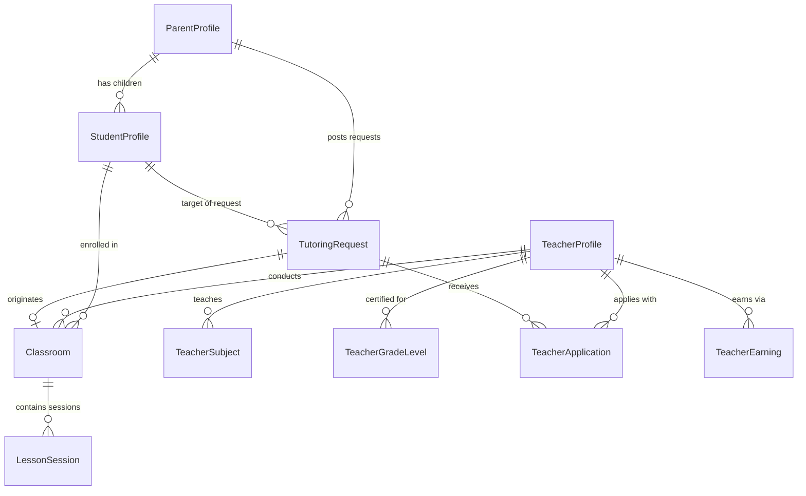
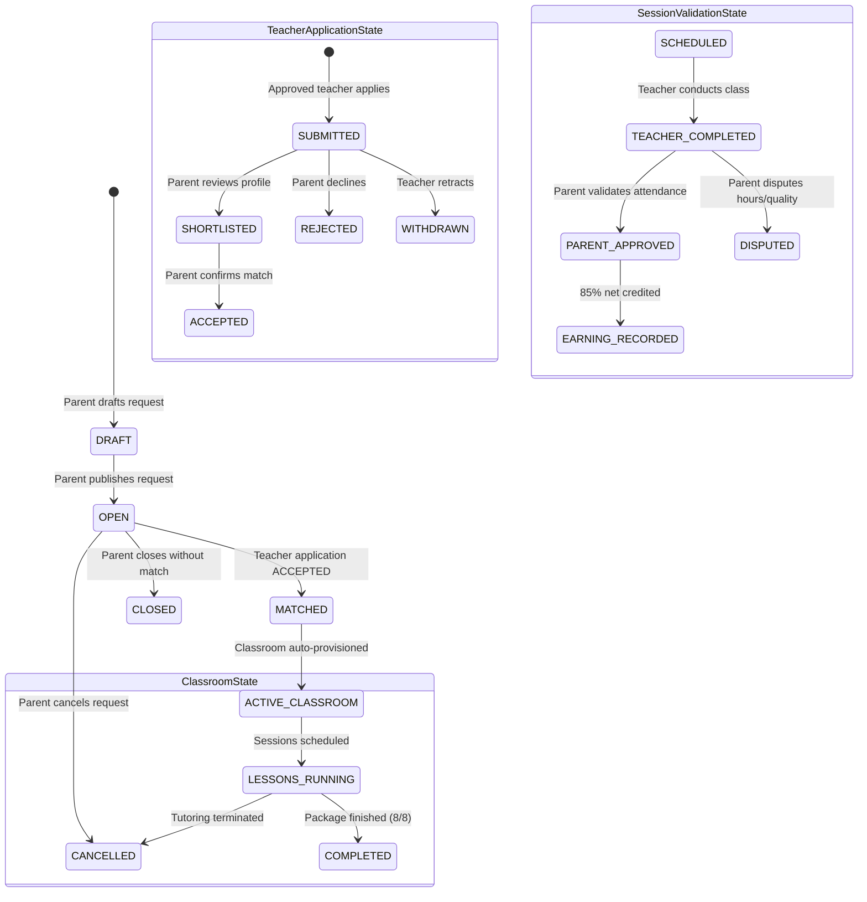
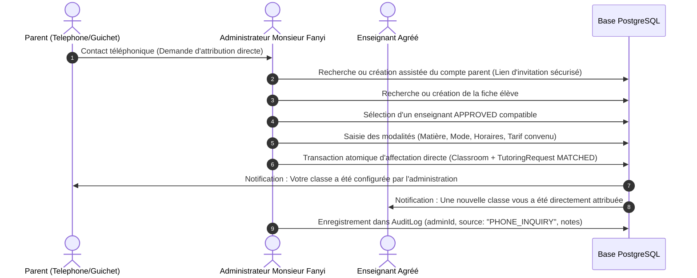

# MONSIEUR FANYI — MILESTONE 2: MARKETPLACE ARCHITECTURE & DATA FOUNDATIONS
**Document Version:** 2.0.0 (Milestone 2 — Phase 05)  
**Standard:** SRD V2.0 Pédagogique & Marché Guinéen  
**Author:** Principal Software Architect & Full-Stack Engineering Team  

---

## 1. Executive Summary & Core Business Invariants

Monsieur Fanyi is a French-first tutoring marketplace for Guinea (`fr-GN`), connecting verified educators with families. All financial workflows follow the platform business rules:
- **Platform Commission:** 15%
- **Teacher Remuneration:** 85%
- **Currency:** Guinean Franc (`GNF`)
- **Timezone:** `Africa/Conakry` (GMT)
- **Advanced Escrow:** Parents fund package sessions in advance.
- **Teacher Payout Eligibility:** Funds become eligible for disbursement only after individual sessions are delivered by the teacher and validated by the parent (`PARENT_APPROVED`).
- **Data Isolation:** Teachers only see students with whom they have an active or completed tutoring relationship (`Classroom`). Newly registered or unassigned teachers see zero students.

---

## 2. Marketplace Data Entities (P05.08)

The data model is implemented via PostgreSQL and Prisma ORM without destructive migrations:

### 2.1 Entity Schema Definitions

1. **`TutoringRequest`**
   - `id`: CUID primary key
   - `parentId`: Foreign key to `ParentProfile`
   - `studentId`: Foreign key to `StudentProfile`
   - `subjectId`: Foreign key to master `Subject` (or null if custom)
   - `subjectName`: Name of standard or custom subject
   - `customSubject`: String description if "Autre" is selected
   - `gradeLevelName`: Target grade or level
   - `cycle`: Educational cycle (`PRIMAIRE`, `COLLEGE`, `LYCEE`, `SUPERIEUR`, `AUTRE`)
   - `customCycle`: Specialized training description if "AUTRE"
   - `preferredMode`: `ONLINE`, `IN_HOME`, or `HYBRID`
   - `commune`: Conakry commune or Guinean prefecture
   - `locationAddress`: Neighborhood / street details
   - `hourlyBudgetGnf`: Target budget per hour
   - `monthlyBudgetGnf`: Expected package total
   - `sessionsPerMonth`: Target session count (default 8)
   - `status`: `DRAFT` | `OPEN` | `MATCHED` | `CLOSED` | `CANCELLED`

2. **`TeacherApplication`**
   - `id`: CUID primary key
   - `tutoringRequestId`: Foreign key to `TutoringRequest`
   - `teacherProfileId`: Foreign key to `TeacherProfile` (must be `APPROVED`)
   - `proposedRateGnf`: Teacher's proposed hourly rate
   - `proposedMonthlyPackageGnf`: Monthly total proposed
   - `coverLetter`: Pedagogical note to the parent
   - `status`: `SUBMITTED` | `SHORTLISTED` | `ACCEPTED` | `REJECTED` | `WITHDRAWN`
   - `createdAt`, `updatedAt`

3. **`Classroom`**
   - `id`: CUID primary key
   - `tutoringRequestId`: Optional origin request ID
   - `teacherProfileId`: Foreign key to `TeacherProfile`
   - `studentId`: Foreign key to `StudentProfile`
   - `subjectName`: Course subject
   - `customSubject`: Custom specification if applicable
   - `mode`: `IN_HOME` | `ONLINE`
   - `hourlyRateGnf`: Agreed hourly rate
   - `monthlyRateGnf`: Agreed monthly package
   - `status`: `ACTIVE` | `PAUSED` | `COMPLETED` | `CANCELLED`

4. **`LessonSession`**
   - `id`: CUID primary key
   - `classroomId`: Foreign key to `Classroom`
   - `scheduledStart`: Scheduled start timestamp
   - `scheduledEnd`: Scheduled end timestamp
   - `durationMinutes`: Session duration (default 120 minutes)
   - `status`: `SCHEDULED` | `TEACHER_COMPLETED` | `PARENT_APPROVED` | `DISPUTED` | `CANCELLED`
   - `teacherSummary`: Notes submitted after teaching
   - `parentFeedback`: Parent comment / rating

5. **`TeacherEarning`**
   - `id`: CUID primary key
   - `teacherProfileId`: Foreign key to `TeacherProfile`
   - `lessonSessionId`: Unique foreign key to `LessonSession`
   - `grossAmountGnf`: Full parent fee for the lesson
   - `commissionAmountGnf`: Platform commission (15%)
   - `teacherNetGnf`: Teacher earnings (85%)
   - `isWithdrawn`: Boolean flag for disbursement
   - `withdrawnAt`: Timestamp when paid via Orange Money / MTN MoMo

---

## 3. Deterministic Matching Algorithm Foundation (P05.09)

Marketplace matching operates strictly deterministically without opaque heuristics. Only **`APPROVED`** teachers are eligible for matching.

### 3.1 Five-Pillar Match Criteria

1. **Teacher Verification Gate (Absolute Invariant):**
   $$\text{teacherProfile.verificationStatus} = \text{APPROVED}$$
   Teachers in `DRAFT`, `PENDING_REVIEW`, or `REJECTED` status are excluded from marketplace matching.

2. **Subject Match (Standard & Custom "Autre"):**
   - *Standard:* $\text{teacherSubjects} \cap \{\text{request.subjectId}\} \neq \emptyset$
   - *Custom "Autre":* If `request.subjectName = "Autre"`, matches teachers who also registered "Autre" or whose `customSubject` shares key semantic tokens (e.g., "Russe", "Robotique").

3. **Educational Cycle & Grade Match:**
   - *Standard:* $\text{teacherGradeLevels} \cap \{\text{request.gradeLevelId}\} \neq \emptyset$
   - *Custom "Autre":* If `request.cycle = "AUTRE"`, matches teachers with `customGradeLevel` certified for specialized training.

4. **Tutoring Modality Compatibility:**
   - If `request.preferredMode = IN_HOME` $\implies \text{teacher.isHomeAvailable} = \text{true}$
   - If `request.preferredMode = ONLINE` $\implies \text{teacher.isOnlineAvailable} = \text{true}$

5. **Geographic Proximity (for In-Home Lessons):**
   - Conakry Communes: Kaloum, Dixinn, Matam, Ratoma, Matoto, Sanoyah, Kagbélen, Dubréka, Coyah.
   - Match when `request.commune` falls within `teacher.serviceArea` or `teacher.city`.

---

## 4. Application Workflow State Machine (P05.10)

### 4.1 State Invariants

- **No Student Auto-Assignment:** Publishing a tutoring request or creating a child profile NEVER assigns an unconfirmed teacher.
- **No Free-Floating Classes:** A `Classroom` can only be instantiated upon explicit parent acceptance of a teacher's application or admin-facilitated matching.
- **Strict 85% Split:** When `LessonSession` reaches `PARENT_APPROVED`, a `TeacherEarning` record is created:
  $$\text{gross} = \frac{\text{monthlyPackageRateGnf}}{\text{monthlyPackageSessions}}$$
  $$\text{teacherNet} = \text{gross} \times 0.85$$
  $$\text{commission} = \text{gross} \times 0.15$$

---

## 5. Role-Based Permission Matrix (P05.11)

| Operation | Parent | Teacher (`APPROVED`) | Teacher (`PENDING`/`DRAFT`) | Administrator | Student |
|:---|:---:|:---:|:---:|:---:|:---:|
| Create Student Profile | Yes (own children) | No | No | Yes (all) | No |
| View Student Profile | Yes (own children) | Yes (assigned in Classroom) | No | Yes (all) | Read-only |
| Update Student Profile | Yes (own children) | No | No | Yes | No |
| Create Tutoring Request | Yes | No | No | Yes | No |
| Browse Open Requests | No | Yes | No | Yes | No |
| Submit Application | No | Yes | No (Blocked) | No | No |
| Accept Application | Yes (own request) | No | No | Yes | No |
| Mark Session Completed | No | Yes (own classroom) | No | Yes | No |
| Approve Session & Release Funds | Yes (own classroom) | No | No | Yes (dispute mediation)| No |
| View Earnings & Commissions | No | Yes (own 85%) | No (0 GNF) | Yes (15% platform total)| No |

---

## 6. Verification and Compliance

All implementations adhere strictly to the non-negotiable architectural mandates:
- Query-level data filtering in `src/lib/auth/parent-guard.ts` and `src/lib/auth/teacher-guard.ts`.
- Zero mock student leak into operational dashboards.
- Seamless "Autre" support across educational cycles and subjects.

---

## 7. Phase 06 Implementation: Complete Parent Tutoring Request System

Phase 06 delivers the complete database-connected tutoring request lifecycle for parents:

### 7.1 Architecture & Separation of Concerns
- **Explicit Request Creation:** Student registration is completely decoupled from tutoring requests. Creating a child profile never generates a request automatically.
- **Multi-Request Support:** Parents can create unlimited independent requests per child (e.g. separate requests for Math, Physics, and English), each with its own budget, format, schedule, and lifecycle.
- **Confidentiality:** Exact street addresses (`locationAddress`) are strictly protected from public discovery; only `commune` and `neighborhood` are visible for tutor matching.

### 7.2 Request Lifecycle State Machine (`src/lib/tutoring-request/state-machine.ts`)
| Status | Description | Allowed Next States | Editable? | Cancellable? |
|:---|:---|:---|:---:|:---:|
| `DRAFT` | In-progress draft; partial data permitted | `OPEN`, `CANCELLED` | Yes | Yes |
| `OPEN` | Published on marketplace for verified teachers | `MATCHED`, `CANCELLED`, `CLOSED` | Yes | Yes |
| `MATCHED` | Teacher application accepted; class being provisioned | `CLOSED` | No | No |
| `CLOSED` | Completed tutoring engagement | None | No | No |
| `CANCELLED` | Retracted by parent with timestamp & reason | None (Terminal) | No | No |

### 7.3 Implemented API Endpoints & Security
- `GET /api/parent/requests`: Lists authenticated parent's requests with counts, filters, search, and pagination.
- `POST /api/parent/requests`: Creates a new `DRAFT` or directly publishes an `OPEN` request. Enforces `verifyStudentOwnership` (anti-IDOR) and records audit logs.
- `GET /api/parent/requests/[id]`: Retrieves full details with strict parent ownership check.
- `PATCH /api/parent/requests/[id]`: Updates request fields if status is `DRAFT` or `OPEN`.
- `POST /api/parent/requests/[id]/publish`: Validates all required criteria (`budgetGnf` $\ge$ 50,000 GNF, valid cycle, commune for HOME mode) and sets status to `OPEN`.
- `POST /api/parent/requests/[id]/cancel`: Marks request `CANCELLED`, records `cancelledAt` and `cancellationReason`.

### 7.4 UI & Components (`src/components/requests/`)
- `ParentRequestsClient.tsx`: Comprehensive request management dashboard.
- `TutoringRequestWizard.tsx`: 6-step guided modal wizard with progress indicators and inline validation.
- `RequestCard.tsx`: Rich card with status badges, budget badges, and quick action buttons.
- `RequestStatusBadge.tsx`: Color-coded accessible badges.
- `RequestSummaryCounters.tsx`: Status metric counters with filter tabs.
- `RequestFilterBar.tsx`: Dynamic student selector, search input, and status filters.
- `RequestActionDialog.tsx`: Modal for cancellation with optional reason capture.
- `RequestDetailsClient.tsx`: Full single-request inspection view with student dossier, logistics, and teacher application preview.

---

## 8. Phase 07 Implementation: Teacher Marketplace Discovery, Matching & Applications

Phase 07 delivers the complete teacher-side marketplace experience, deterministic matching, and application workflow:

### 8.1 Teacher Eligibility & Strict Gates
- **Approved Teacher Invariant:** Only teachers with `verificationStatus === 'APPROVED'` and active user accounts (`isActive === true`) can discover detailed opportunities and submit applications (`requireApprovedTeacherAuth()`).
- **Unapproved / Inactive Restriction:** Teachers in `DRAFT`, `PENDING_REVIEW`, `REJECTED`, or `isActive === false` are prevented from submitting applications with server-side 403 responses.

### 8.2 Database Architecture & Lifecycle (`TeacherApplication`)
- **Prisma Model:**
  - `id`: CUID unique identifier.
  - `requestId`: Foreign key to `TutoringRequest`.
  - `teacherProfileId`: Foreign key to `TeacherProfile`.
  - `pitchMessage`: Pedagogical message and approach summary.
  - `proposedRateGnf`: Integer GNF rate (monthly or hourly).
  - `proposedRateType`: `"MONTHLY"` | `"HOURLY"`.
  - `sessionArrangement`: Proposed frequency & duration (e.g. 2 sessions of 2h/week).
  - `availabilityNotes`: Time slot preferences.
  - `status`: `SUBMITTED` | `SHORTLISTED` | `ACCEPTED` | `REJECTED` | `WITHDRAWN`.
  - `withdrawnAt`, `decisionAt`, `rejectionReason`.
  - `@@unique([requestId, teacherProfileId])`: Anti-duplicate constraint at PostgreSQL engine level.

### 8.3 Deterministic Matching Engine (`src/lib/marketplace/matching.ts`)
- **Pillar 1 — Verification Status:** Only `APPROVED` teachers receive positive matching scores.
- **Pillar 2 — Subject Match:** Standard subjects matched via IDs/names; custom `"Autre"` subjects matched using token normalization (`normalizeToken`) without naive string collapse.
- **Pillar 3 — Educational Level & Cycle:** Grade-level exact match or cycle compatibility (`PRIMAIRE`, `COLLEGE`, `LYCEE`, `SUPERIEUR`, `AUTRE`).
- **Pillar 4 — Teaching Mode Compatibility:** In-home lessons require `isHomeAvailable`; online lessons require `isOnlineAvailable`.
- **Pillar 5 — Geographic Proximity:** For in-home requests, verifies commune coverage in Conakry (`Ratoma`, `Dixinn`, `Kaloum`, `Matam`, `Matoto`, etc.).
- **Recommendation Threshold:** Requests with `score >= 60` and subject compatibility are flagged `isRecommended = true`.

### 8.4 Server-Side Privacy & RBAC Invariants
- **Data Protection:** Marketplace discovery queries strictly exclude parent phone numbers, parent email, and precise home street addresses (`locationAddress`). Teachers view only city, commune, and neighborhood.
- **No Free-Floating Classes:** Application submission NEVER assigns a student, creates a classroom, or generates financial payouts (Phase 08 boundary preserved).
- **Anti-IDOR:** Teachers can only view and withdraw their own applications. Cross-teacher modification returns 403.

### 8.5 Implemented API Endpoints
- `GET /api/teacher/opportunities`: Lists all `OPEN` requests with pagination, multi-faceted filtering (subject, cycle, mode, commune), and deterministic match scoring.
- `GET /api/teacher/opportunities/[id]`: Returns non-sensitive details of an opportunity, match analysis, and the teacher's application state.
- `POST /api/teacher/applications`: Transactional application submission with strict eligibility verification, anti-duplicate constraint, and parent notification.
- `GET /api/teacher/applications`: Returns authenticated teacher's submitted applications with status counters.
- `POST /api/teacher/applications/[id]/withdraw`: State machine transition from `SUBMITTED` or `SHORTLISTED` to `WITHDRAWN`.

### 8.6 Frontend Components & UX (`src/components/teacher/`)
- `TeacherMarketplaceClient.tsx`: Discovery hub with two views ("Recommandées pour vous" vs "Toutes les demandes disponibles"), search bar, multi-select filters, and empty/loading states.
- `OpportunityCard.tsx`: Reusable card with match score badges, logistics, and call-to-actions.
- `OpportunityDetailClient.tsx`: Comprehensive opportunity inspection with match breakdown, pedagogical goals, and application management.
- `TeacherApplicationForm.tsx`: Professional application form with 85%/15% financial split preview and live validation.
- `TeacherApplicationsClient.tsx`: My Applications tracking hub with KPI tabs (`All`, `Submitted`, `Shortlisted`, `Accepted`, `Withdrawn`, `Rejected`) and withdrawal confirmation workflow.
- `LightSidebar.tsx` & `LightDashboardView.tsx`: Navigation items for "Opportunités" and "Mes Candidatures", and dashboard quick-access widget with real PostgreSQL counts.

---

## 9. Administrator-Assisted Direct Tutoring Assignment Architecture (Phase 08 — Avenant +50 €)

### 9.1 Business Purpose & Assisted Flow
Many Guinean parents reach out to Monsieur Fanyi via telephone or in-person office visits. To address this reality without compromising digital traceability, administrators possess an assisted matching workflow:

### 9.2 Invariants et Règles Non-Négociables (Phase 08)
1. **Éligibilité Enseignant :** Seuls les enseignants avec `verificationStatus === 'APPROVED'` peuvent être sélectionnés.
2. **Confidentialité & Anti-IDOR :** L'administrateur opère via des contrôles stricts de session (`UserRole.ADMIN`) ; aucune donnée de famille tierce n'est divulguée.
3. **Sécurité des Mots de Passe :** Aucun mot de passe en clair n'est généré ni transmis par l'administrateur. Un token d'invitation/activation sécurisé est envoyé au parent.
4. **Zéro Paiement ni Gain Fictif :** La création de la classe ne génère **aucun paiement fictif ni gain professeur**. Le séquestre préalable reste obligatoire avant la première séance.
5. **Prévention des Doublons :** Vérification stricte d'unicité de classe par demande et par couple enseignant/élève actif.

---

## 10. Structured Lesson Records & Attendance Architecture (Phases 10–11)

### 10.1 Données Structurées de Séance
Pour préparer le carnet de progression numérique, le cycle de vie de chaque séance (`LessonSession`) et son compte-rendu (`LessonReport`) capturent des données vérifiables :

- **Présence (`LessonAttendance`) :** `PRESENT`, `ABSENT_STUDENT`, `ABSENT_TEACHER`, `EXCUSED`, `LATE`.
- **Horaires Réels :** `actualStart`, `actualEnd`, `actualDurationMinutes`.
- **Contenu Pédagogique :** `topicsCovered`, `studentEffort`, `teacherNotes`.
- **Devoirs :** `homeworkGiven`, `homeworkDueDate`.
- **Évaluations Périodiques :** `assessmentTitle`, `assessmentScore`, `assessmentMaxScore`, `assessmentComment`.
- **Progression Globale :** `progressRating` (1 à 5).

### 10.2 Invariant de Rémunération
La soumission d'un rapport de séance par l'enseignant passe le statut de la séance à `TEACHER_COMPLETED`, mais **ne débloque aucun paiement**. Les 85 % nets deviennent éligibles au versement uniquement après validation explicite par le parent (`PARENT_APPROVED`).

---

## 11. Carnet de Progression Numérique — Advanced Digital Progress Book (Phase 12 — Avenant +50 €)

### 11.1 Fonctionnalités par Rôle
Le **Carnet de progression numérique** est un composant central unifié accessible selon les permissions RBAC :

| Fonctionnalité | Enseignant | Parent | Administrateur |
| :--- | :---: | :---: | :---: |
| Saisie du compte-rendu de séance structuré | Oui (classes assignées) | Non | Lecture seule |
| Enregistrement des présences et durée effective | Oui | Non | Lecture seule |
| Attribution de devoirs avec date d'échéance | Oui | Non | Lecture seule |
| Saisie des notes d'évaluations périodiques | Oui | Non | Lecture seule |
| Consultation de la chronologie d'apprentissage | Oui (ses élèves) | Oui (ses enfants) | Oui (supervision) |
| Visualisation graphique de la progression par matière | Oui | Oui | Oui |
| Validation ou contestation de séance | Non | Oui (ses séances) | Arbitrage litiges |
| Surveillance des rapports manquants | Non | Non | Oui (tableau de bord) |

### 11.2 Intégrité des Données Pédagogiques
- **Données Réelles Uniquement :** Tous les graphiques et moyennes par matière reposent exclusivement sur des notes et appréciations réellement enregistrées. Aucune donnée n'est extrapolée ou simulée.
- **Historique Immuable :** Les rapports validés et les contestations demeurent archivés pour consultation et traçabilité.

