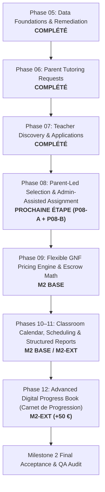

# MONSIEUR FANYI — MILESTONE 2 SCOPE UPDATE & ROADMAP
## Architecture, Contractual Distinction & Phase-by-Phase Implementation Plan

**Document Version:** 2.1.0  
**Date:** 7 Novembre 2026  
**Author:** Principal Software Architect & Lead Full-Stack Engineer  
**Status:** Approved & Synchronized with SRD V2.0  

---

### 1. Contractual Distinction & Scope Clarification

To preserve absolute commercial and delivery transparency, the scope of Milestone 2 is organized into two distinct contractual tiers:

| Contract Tier | Scope Coverage | Budget / Terms | Status |
| :--- | :--- | :---: | :---: |
| **Milestone 2 Base** *(Original SRD V2.0)* | Parent Tutoring Requests (Phases 05–06), Teacher Discovery & Applications (Phase 07), Parent-Led Teacher Selection (Phase 08-A), Flexible GNF Pricing (Phase 09), Classroom Calendar & Scheduling (Phases 10–11), Standard Session Reports & Parent Validation. | **$200 / 200 €** *(Original M2 Contract)* | In Progress (Phases 05–07 Completed; P08–P11 active) |
| **Milestone 2 Enhancement** *(Avenant Agréé)* | **1. Attribution Directe Assistée par l'Administrateur** (Phase 08-B) : Création sécurisée de compte parent/élève et affectation directe de professeur approuvé sans candidature préalable pour les familles contactant l'équipe par téléphone.<br>**2. Carnet de Progression Numérique Avancé** (Phase 12) : Devoirs structurés, évaluations périodiques, graphiques réels d'évolution par matière, chronologie d'apprentissage multi-rôles. | **+50 €** *(Avenant séparé)* | Scheduled (Phase 08-B & Phase 12) |

---

### 2. Implementation Status & Phase-by-Phase Execution Plan

Development strictly proceeds **one phase at a time**. No premature implementation of payment settlement (Milestone 3) is permitted.



---

### 3. Detailed Phase Specifications

#### 3.1 Phase 08: Teacher Selection & Classroom Generation (Parent-Led & Admin-Assisted)
Phase 08 incorporates two complementary workflows generating real, database-backed classrooms:

1. **Workflow A: Parent-Led Application Acceptance (`REQ-MATCH-03`)**
   - Parents review applications submitted by approved teachers in Phase 07 via `/parent/requests/[id]`.
   - Parent accepts a candidate; transaction atomically marks the request `MATCHED`, creates a single `Classroom`, and notifies the teacher.
   - Other competing applications are cleanly resolved.

2. **Workflow B: Administrator-Assisted Direct Tutoring Assignment (`REQ-ADMIN-ASSIGN-01` & `REQ-ADMIN-ASSIGN-02` — Avenant +50 €)**
   - Dedicated administrative hub `/admin/assignments`.
   - **Parent Discovery or Assisted Registration:** Admin can select an existing parent or initiate account creation for parents calling by phone.
   - **Password Security Invariant:** The system **never** generates, stores, or transmits plaintext passwords on behalf of parents. A secure activation/invitation token is dispatched.
   - **Student Profile Association:** Admin selects or creates the student profile with educational cycle and grade level.
   - **Teacher Selection Gate:** Only teachers with `TeacherVerificationStatus.APPROVED` and active accounts can be selected.
   - **Terms Specification:** Subject, educational cycle, mode (`HOME`, `ONLINE`, `HYBRID`), commune/neighborhood, agreed rate (GNF), and schedule preferences.
   - **Atomic Assignment:** Creates an assisted `TutoringRequest` (`status: MATCHED`, `isAssisted: true`) and a single `Classroom` (`isAssistedAssignment: true`, `assignedByAdminId: adminUser.id`, `adminNotes`, `assignmentSource: "PHONE_INQUIRY"`).
   - **Zero Fictitious Money Invariant:** Does NOT create fake payments or teacher earnings. Advance escrow payment remains mandatory before lessons begin.
   - **Audit Trail:** Immutable `AuditLog` entry documenting administrator identity, timestamp, and source.

#### 3.2 Phase 09: Flexible GNF Pricing Engine & Escrow Advance Allocation (`REQ-TARIF-01`, `REQ-TARIF-02`)
- Strict Guinean Franc integer arithmetic (zero floating-point math).
- Hourly rates vs. Monthly package rates (8 sessions, 2 hours/session).
- Exact package allocation algorithm (`allocatePackageSessions`): deterministic remainder distribution ensuring the sum of sessions strictly equals the package total.
- 15% platform commission / 85% teacher remuneration split calculation.

#### 3.3 Phases 10–11: Classroom Calendar, Lesson Scheduling & Structured Reports (`REQ-CLASS-01`, `REQ-SEANCE-01`–`03`)
- Class dashboard for Parent and Teacher with weekly/monthly scheduling in `Africa/Conakry` (GMT).
- `LessonSession` tracking: scheduled vs. actual times, attendance status (`PRESENT`, `ABSENT_STUDENT`, `ABSENT_TEACHER`, `EXCUSED`, `LATE`).
- `LessonReport` submission by the assigned teacher: topics covered, student effort diagnostic, homework assigned with due date, and assessment scores.
- Parent validation state machine: `SCHEDULED` $\rightarrow$ `TEACHER_COMPLETED` $\rightarrow$ `PARENT_APPROVED` or `PARENT_DISPUTED`.
- Invariant: A submitted report does **not** unlock teacher earnings without explicit parent approval.

#### 3.4 Phase 12: Advanced Digital Progress Book — *Carnet de Progression Numérique* (`REQ-PROG-01`–`04` — Avenant +50 €)
- **Teacher Workspace:** Structured reporting tool, homework assignment with instructions and deadlines, periodic test scoring, subject progress observations, and chronological report archives.
- **Parent Workspace:** Transparent student learning timeline, individual lesson review, attendance calendar, homework checklist, periodic grades, and validation actions accessible via mobile and desktop.
- **Administrator Workspace:** National progress surveillance, missing report monitors, attendance metrics, and dispute audit tools.
- **Progress Visualizations:** Real-data subject progress cards (`SubjectProgressCard`) and charts (`ProgressChart`). **Absolute Invariant:** Zero invented or extrapolated grades; charts display strictly recorded historical evaluation data.

---

### 4. Database Schema Foundations (Prisma Synchronized)

The PostgreSQL database schema has been prepared with full backward compatibility:

```prisma
enum LessonAttendance {
  PRESENT
  ABSENT_STUDENT
  ABSENT_TEACHER
  EXCUSED
  LATE
}

model Classroom {
  id                    String            @id @default(cuid())
  requestId             String?           @unique
  request               TutoringRequest?  @relation(fields: [requestId], references: [id], onDelete: SetNull)
  teacherProfileId      String
  teacherProfile        TeacherProfile    @relation(fields: [teacherProfileId], references: [id], onDelete: Restrict)
  studentId             String
  student               StudentProfile    @relation(fields: [studentId], references: [id], onDelete: Restrict)
  subjectName           String
  mode                  TutoringMode      @default(HOME)
  hourlyRateGnf         Int?
  monthlyRateGnf        Int?
  isAssistedAssignment  Boolean           @default(false)
  assignedByAdminId     String?
  assignedByAdmin       User?             @relation("AdminAssignedClassrooms", fields: [assignedByAdminId], references: [id], onDelete: SetNull)
  adminNotes            String?
  assignmentSource      String?           // e.g. "PHONE_INQUIRY", "DIRECT_OFFICE"
  externalVideoUrl      String?
  status                ClassroomStatus   @default(ACTIVE)
  createdAt             DateTime          @default(now())
  updatedAt             DateTime          @updatedAt

  sessions              LessonSession[]
  messages              ClassroomMessage[]
  orders                PaymentOrder[]
  attachments           Attachment[]

  @@index([teacherProfileId])
  @@index([studentId])
  @@index([isAssistedAssignment])
  @@index([assignedByAdminId])
}

model LessonSession {
  id                    String            @id @default(cuid())
  classroomId           String
  classroom             Classroom         @relation(fields: [classroomId], references: [id], onDelete: Cascade)
  scheduledStart        DateTime
  scheduledEnd          DateTime
  actualStart           DateTime?
  actualEnd             DateTime?
  durationMinutes       Int               @default(60)
  actualDurationMinutes Int?
  attendanceStatus      LessonAttendance  @default(PRESENT)
  allocatedAmountGnf    Int               @default(0)
  isFunded              Boolean           @default(false)
  status                SessionStatus     @default(SCHEDULED)
  createdAt             DateTime          @default(now())
  updatedAt             DateTime          @updatedAt

  report                LessonReport?
  approval              LessonApproval?
  dispute               LessonDispute?
  earning               TeacherEarning?
  refundCases           RefundCase[]

  @@index([classroomId])
  @@index([status])
  @@index([attendanceStatus])
}

model LessonReport {
  id                  String        @id @default(cuid())
  sessionId           String        @unique
  session             LessonSession @relation(fields: [sessionId], references: [id], onDelete: Cascade)
  topicsCovered       String
  studentEffort       String?
  homeworkGiven       String?
  homeworkDueDate     DateTime?
  teacherNotes        String?
  assessmentTitle     String?
  assessmentScore     Float?
  assessmentMaxScore  Float?
  assessmentComment   String?
  progressRating      Int?          // 1 to 5 scale
  submittedAt         DateTime      @default(now())
  updatedAt           DateTime      @default(now()) @updatedAt

  @@index([sessionId])
}
```

---

### 5. Requirements Traceability Checklist

- [x] **REQ-AUTH-01 to 03:** Secure authentication, Bcrypt hashing, password reset tokens *(M1 — Completed)*
- [x] **REQ-PROF-01 to 04:** Teacher and parent profiles, verification document upload & review *(M1 — Completed)*
- [x] **REQ-DEM-01 & 02:** Parent tutoring requests, draft/open/cancel state machine, student decoupling *(Phase 06 — Completed)*
- [x] **REQ-MATCH-01 & 02:** Teacher marketplace discovery, 5-pillar matching, applications, withdrawal *(Phase 07 — Completed)*
- [ ] **REQ-MATCH-03:** Parent-led teacher selection from submitted applications *(Phase 08-A — Next)*
- [ ] **REQ-ADMIN-ASSIGN-01:** Admin-assisted direct assignment for telephone/walk-in families *(Phase 08-B — Avenant +50 €)*
- [ ] **REQ-ADMIN-ASSIGN-02:** Passwordless/secure parent invitation & financial integrity of assisted assignment *(Phase 08-B — Avenant +50 €)*
- [ ] **REQ-TARIF-01 & 02:** Flexible GNF pricing offers & exact package allocation *(Phase 09)*
- [ ] **REQ-CLASS-01:** Classroom space, weekly scheduling calendar *(Phases 10–11)*
- [ ] **REQ-SEANCE-01 & 02:** Teacher completion reporting & parent lesson approval/dispute *(Phases 10–11)*
- [ ] **REQ-SEANCE-03:** Structured lesson records with attendance and duration *(Phases 10–11)*
- [ ] **REQ-PROG-01:** Digital progress book teacher reporting, homework, assessments *(Phase 12 — Avenant +50 €)*
- [ ] **REQ-PROG-02:** Digital progress book parent timeline, homework & grade review *(Phase 12 — Avenant +50 €)*
- [ ] **REQ-PROG-03:** Digital progress book admin monitoring & missing report alerts *(Phase 12 — Avenant +50 €)*
- [ ] **REQ-PROG-04:** Subject-level progress cards and charts with 100% authentic data *(Phase 12 — Avenant +50 €)*

---

### 6. Non-Negotiable Architectural Rules & Invariants

1. **Approved Teacher Verification Gate:** Only teachers with `APPROVED` status can be matched (either via parent selection or admin assignment).
2. **Confidentiality:** Exact student residential addresses and family telephone numbers remain restricted until an authorized tutoring relationship is established.
3. **Password Security:** Administrators **never** generate, view, or transmit plaintext passwords. Parents invited via assisted registration activate accounts via signed cryptographic tokens.
4. **Advance Payment Rule:** Creating a classroom (assisted or parent-led) does **not** start lessons or create earnings. Parents must fund sessions in advance before delivery begins.
5. **Strict 85% / 15% Division:** Teacher net earnings (85%) become payable only after individual sessions reach `PARENT_APPROVED`.
6. **No Fabricated Academic Data:** Charts and averages in the *Carnet de progression numérique* reflect strictly recorded teacher evaluations.
7. **Bilingual Parity:** French (`fr-GN`) remains the default; English (`en`) translations must achieve complete key parity.
8. **Phase Isolation:** Execute one phase at a time. Conclude each phase with full automated test coverage before initiating the next.

